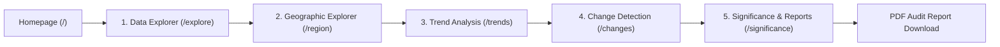

# Earth Science Explorer — Live Demonstration Guide

This guide specifies the exact demonstration path, recommended datasets, parameters, and spoken talking points for showcasing the **Earth Science Explorer** application in accordance with the project specification (`docs/SPEC.md`) and core scientific rules (`AGENTS.md`).

---

## 1. Demonstration Scenario Summary

| Parameter | Recommended Setting | Scientific Rationale |
| :--- | :--- | :--- |
| **Primary Variable** | **Precipitation** (`precipitation`) | Longest continuous observational record (1979–present), non-zero seasonality, and high climate relevance. |
| **Dataset Product** | **GPCP Monthly Mean v2.3** (`gpcp_monthly_v23`) | NASA/NOAA blended satellite-gauge product, $2.5^\circ \times 2.5^\circ$ equal-angle grid, monthly rate (`mm/day`). |
| **Study Region** | **Chad** (`admin0_tcd_chad`) | Continental Sahel interior with strong latitudinal precipitation gradient, well-documented historical drought/recovery phases, and clear spatial FDR patterns. |
| **Date Range** | **1990-01-01 to Latest Complete** (`2026-10-01`) | 36+ years (442 monthly intervals), complete observation series without partial current-month distortion. |
| **Baseline Period (A)** | **1990 – 2005** (16 years) | Pre-recent climate comparison baseline. |
| **Comparison Period (B)**| **2006 – 2023** (18 years) | Contemporary climate period. Non-overlapping by default. |
| **Temporal Aggregation**| **Monthly** | Native resolution for GPCP v2.3 rate accumulation. |

---

## 2. Step-by-Step Click Path

### Step 0: Homepage (`/`)
1. **Navigate to:** `http://localhost:5173/` (or production host).
2. **Observe:**
   - Dark navy theme (`#0b0f19`) with cyan/blue accents and high-contrast typography.
   - Header showing system connection status chip (`Available`).
   - "What You Can Do" workflow cards highlighting the 5 sequential phases.
3. **Action:** Click **"Start Exploring"** (or click the **"Explore Data"** card).

---

### Step 1: Data Explorer (`/explore`)
1. **Observe Catalog Grid:**
   - Variables are listed with real catalog metadata (Atmosphere, Land, Ocean).
   - Notice the status chips: `Available` for GPCP and MERRA-2, with honest `Unavailable` chips for unseeded experimental records.
2. **Select Precipitation:**
   - Click on the **Precipitation** card.
   - Observe that **GPCP v2.3** is selected as the primary dataset.
3. **Inspect Provenance & Details:**
   - Click the **"Details"** button on the GPCP v2.3 card.
   - The sliding drawer opens showing:
     - Canonical source: NOAA PSL THREDDS / NASA Goddard.
     - Spatial resolution: $2.5^\circ \times 2.5^\circ$ grid.
     - Native units: `mm/day` (flux rate).
     - Full citation and DOI link (`https://doi.org/10.5067/MEASURES/GPCP/DATA302`).
     - Known limitations caveat regarding rain gauge density in desert interiors.
   - Click **"Close Drawer"**.
4. **Action:** Click **"Continue to Geographic Explorer"** at the bottom of the Selection Summary sidebar.

---

### Step 2: Geographic Explorer (`/region`)
1. **Observe Persisted State:**
   - The left sidebar displays the persisted selection from Page 1: `precipitation`, `gpcp_monthly_v23`, `monthly`, `1990-01-01`.
2. **Select Chad Boundary:**
   - In the **"Search Countries & States"** input field, type `Chad`.
   - In the dropdown search results, click **"Chad (TCD)"**.
3. **Review Validation Results:**
   - The map zooms to the Chad polygon.
   - The sidebar displays:
     - Geodesic Area: $\approx 1,271,695\text{ km}^2$.
     - Bounding Box: `[13.54°E, 7.42°N, 23.89°E, 23.41°N]`.
     - Grid Cell Centres: Real valid grid centers calculated against the $2.5^\circ$ GPCP grid.
4. **Confirm Region:**
   - Click **"Confirm Selected Region"**.
   - Button transitions to green check: **"Region Confirmed & Stored"**.
5. **Action:** Click **"3. Trend Analysis"** in the top-right header action bar.

---

### Step 3: Trend Analysis (`/trends`)
1. **Observe Automatic Computation:**
   - Real-time time series calculation runs over the 442 monthly intervals (1990–2026).
   - No placeholder numbers or fake points are drawn.
2. **Inspect Interactive Plotly Chart:**
   - Blue curve: observed monthly precipitation rate (`mm/day`).
   - Orange dashed line: 12-month moving average smoothing seasonality.
   - Solid regression line: Ordinary Least Squares (OLS) or Sen's Slope.
   - Cyan shaded envelope: 95% confidence interval band.
3. **Review Metrics Panel:**
   - **Data Completeness:** 100% (442 valid / 442 expected intervals, no missing values).
   - **Rate of Change:** Theil-Sen robust slope vs. OLS slope per year with 95% confidence bounds.
   - **Statistical Tests:** Mann-Kendall $p$-value, modified Hamed-Rao $p$-value, and Seasonal Mann-Kendall ($p < 0.001$).
4. **Action:** Click **"4. Change Detection"** in the top navigation or page header.

---

### Step 4: Spatial Change Detection (`/changes`)
1. **Review Period Configuration:**
   - Baseline Period (A): `1990 – 2005`.
   - Comparison Period (B): `2006 – 2023`.
   - Metric: Absolute Difference ($B - A$) in native units (`mm/day`).
2. **Inspect Spatial Differencing Summary:**
   - **Area-Weighted Mean Change:** Exact cosine-latitude weighted change over the study area.
   - **Domain Share by Direction:** Percentage of domain area experiencing increase, decrease, or no change.
   - **Localized Extremes:** Exact coordinates (lat/lon) of maximum increase and maximum decrease.
   - **Valid Spatial Coverage:** $100\%$ valid grid cells (zero unmasked fill values).
3. **Action:** Click **"5. Significance"** in the top-right action bar.

---

### Step 5: Significance & Evidence (`/significance`)
1. **Observe Dual Hypothesis Tests:**
   - **Regional Test:** Seasonal Mann-Kendall with Hamed-Rao lag-1 autocorrelation variance correction.
   - **Spatial Test:** Benjamini-Hochberg False Discovery Rate (FDR) controlling for multi-testing across spatial grid cells.
2. **Review Classification Cards:**
   - Grid class breakdown: Significant Increase (`+`), Significant Decrease (`−`), Not Significant (`o`), Insufficient Data (`?`).
   - Plain-language synthesis explaining the statistical findings without unsubstantiated claims.
3. **Expand Methodology Drawer:**
   - Click **"Data Quality, Methodology & Limitations"** to inspect mathematical formulas, serial dependence explanations, and spatial correlation notes.

---

### Step 6: Scientific Audit Report Generation & Export
1. **Scroll to:** **"Scientific Audit Report Generator"** panel at the bottom of Page 5.
2. **Inspect Checkboxes:**
   - All 7 standard sections are enabled:
     1. Executive Summary
     2. Dataset and Study Area
     3. Historical Trend Analysis
     4. Spatial Change Detection
     5. Statistical Significance
     6. Data Quality & Limitations
     7. Methodology & References
3. **Action:** Click **"Compile & Export Report"**.
4. **Observe Output Panel:**
   - System compiles all 5 phases into a permanent report entity with a unique ID (e.g. `rep_...`).
   - Direct download links appear:
     - **"Download Report PDF"**: Multi-page publication-grade PDF report.
     - **"Export Series CSV"**: Raw un-downsampled time series CSV.
     - **"Difference GeoTIFF"**: Two-period spatial difference raster.
5. **Verify PDF:**
   - Click **"Download Report PDF"** (or verify via HTTP `GET /api/reports/{id}/pdf`).
   - Confirm the PDF opens cleanly with cover page, methodology, tables, and provenance hashes.

---

## 3. Spoken Script & Key Scientific Principles (Say Out Loud)

When presenting the application, emphasize these exact scientific principles:

1. **"Missing data is never treated as zero."**
   > *"In climate science, zero precipitation means an arid day; missing data means a satellite dropout or unobserved interval. Our backend strictly decodes all fill values (`-9.96921e+36`) to `NaN`. We never interpolate missing observations silently or replace them with zeros."*

2. **"Precipitation is a flux rate, not a state variable."**
   > *"GPCP reports precipitation in `mm/day`. When aggregating from daily or monthly rates into annual totals or multi-year sums, we accumulate by the exact number of days in each month (including leap years), rather than taking an unweighted mean."*

3. **"Every regional mean is area-weighted."**
   > *"On an equal-angle lat-lon grid, grid cells at higher latitudes cover substantially less surface area than equatorial cells. Every regional metric in Earth Science Explorer weights cell values by the cosine of latitude ($w_i = \cos(\phi_i)$) to prevent high-latitude bias."*

4. **"Significance comes from the underlying time samples, not a simple difference map."**
   > *"A difference map only shows the delta between two arbitrary periods. True significance requires analyzing the distribution of underlying time steps. We apply the non-parametric Seasonal Mann-Kendall test with Hamed-Rao variance inflation to correct for serial autocorrelation."*

5. **"Spatial tests use False Discovery Rate (FDR) control."**
   > *"When testing hundreds of grid cells simultaneously, a 5% alpha will produce dozens of false positives purely by chance. We enforce Benjamini-Hochberg FDR adjustments to control false discoveries across the spatial domain."*

6. **"Every result includes version and provenance."**
   > *"Dataset version is part of the dataset ID (e.g. `gpcp_monthly_v23`, version `v2.3`). Every chart, table, and exported report includes its data source, version, processing parameters, and job request ID."*

---

## 4. Known Limitations & Edge Cases to Disclose Honestly

Be completely transparent about these known boundaries:

1. **Spatial Resolution:**
   - GPCP v2.3 has a $2.5^\circ \times 2.5^\circ$ spatial grid ($\approx 275\text{ km}$ at the equator). It is designed for regional, continental, and macro-climate assessments, not localized urban micro-climates or small watersheds.
2. **Gauge Density in Remote Regions:**
   - While GPCP blends microwave/IR satellite readings with Global Precipitation Climatology Centre (GPCC) rain gauge networks, gauge density in the Sahara and central Sahel is sparse.
3. **Spatial Autocorrelation in FDR:**
   - The Benjamini-Hochberg procedure assumes independent or positively dependent test statistics. While it robustly controls false discoveries, strong spatial autocorrelation among adjacent grid cells means nominal FDR rates should be interpreted with awareness of spatial clustering.
4. **In-Memory Fallback vs. PostgreSQL:**
   - If a local PostgreSQL/PostGIS database instance is not running, the application seamlessly falls back to the in-memory YAML catalog and geospatial routines without crashing.
