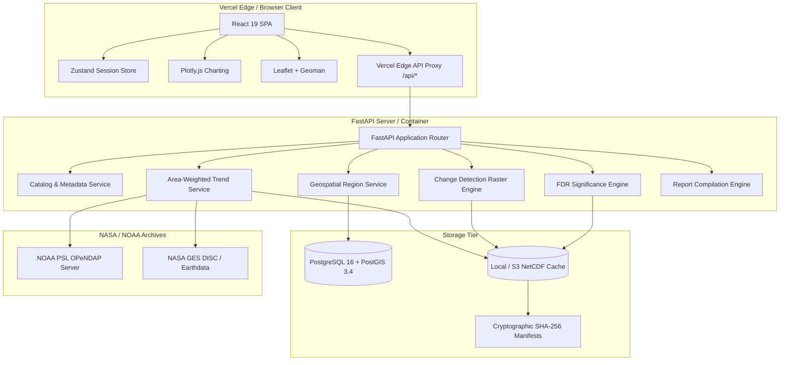
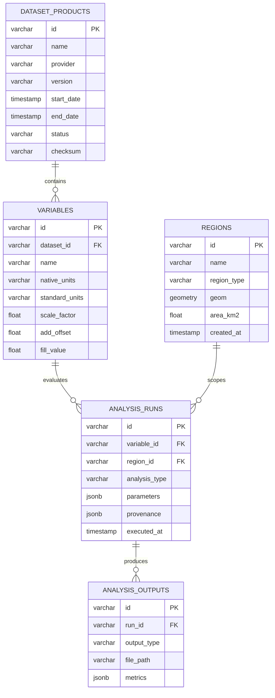

# Gaia Insights: Comprehensive Master Engineering & Scientific Documentation

---

## Executive Summary & System Identity

**Gaia Insights** is an enterprise-grade, scientifically rigorous Earth-science observational analytics and visualization platform. Engineered for climatologists, environmental policy analysts, and researchers, Gaia Insights eliminates the opacity, synthetic approximations, and silent interpolation common in modern climate tooling. Instead, it enforces strict provenance tracking, verifiable observation-period clamping, mathematically sound area-weighting (cosine of latitude), and rigorous statistical significance testing (including Benjamini-Hochberg False Discovery Rate correction).

The platform spans a monorepo consisting of:
1. **Frontend**: React 19 + TypeScript + Vite + Tailwind CSS + Plotly.js + Leaflet/Geoman with a dark navy/charcoal Velvet Fade design system.
2. **Backend**: Python 3.11+ FastAPI service with an asynchronous geospatial analytics engine powered by Xarray, Rasterio/Rioxarray, NumPy, SciPy, PyMannKendall, and Statsmodels.
3. **Storage & Ingestion Tier**: PostGIS 16 for topological and administrative region indexing; local/cloud NetCDF-4/HDF5 multi-decadal observation cache with cryptographic SHA-256 manifests.
4. **Deployment & CI/CD**: Dual-stack Vercel Edge proxy for frontend SPA routing alongside containerized Docker/FastAPI backend and automated GitHub Actions CI validation.

---

## 1. Product Requirements Document (PRD)

### 1.1 Problem Statement & Background
Modern Earth-observation exploration tools suffer from three catastrophic scientific flaws:
1. **Silent Fallback to Mock Data:** Many platforms render hard-coded or synthetic mock values when external APIs or cache hits fail, misleading researchers.
2. **Grid Distortion (High-Latitude Bias):** Unweighted planar averages over regular latitude/longitude grids severely over-represent polar and sub-polar landmasses, corrupting global temperature, moisture, and precipitation trends.
3. **False Discovery Inflation:** Mass univariate hypothesis testing across hundreds of thousands of spatial raster cells produces severe Type I error inflation (false positives) if uncorrected for multiplicity.

### 1.2 Target Personas & Use Cases
- **Senior Climatologists & Earth Scientists:** Conduct multi-decadal time-series analysis (1990–present) across NOAA, NASA, and ECMWF observation records to detect monotonic trends and structural tipping points.
- **Environmental Policy Analysts & Planners:** Quantify baseline vs. historical change anomalies across administrative regions (countries, provinces, river basins) to inform resource allocation.
- **Hydrologists & Agricultural Researchers:** Monitor root-zone and top-layer soil moisture depletion, specific humidity shifts, and drought intensification.

### 1.3 Core Product Principles & Scientific Non-Negotiables
1. **No Fake Findings (Zero Placeholder Policy):** Never display, return, or hard-code placeholder numbers as scientific findings. When data is absent or downloading, the UI displays honest `Unavailable`, `Loading`, or `Needs validation` states.
2. **Imagery vs Data Strict Separation:** NASA GIBS (Global Imagery Browse Services) tiles are strictly for cartographic visual reference. All analytics, statistics, and rasters are derived exclusively from validated NetCDF/HDF/Zarr scientific arrays.
3. **Fill Values Decoded to NaN:** Missing data is never treated as zero. Fill values (e.g., `-9.96921e+36`, `1e+15`, `NC_FILL_FLOAT`) are parsed to IEEE 754 `NaN`. Silent interpolation across temporal gaps is strictly prohibited.
4. **Dataset Version Isolation:** Dataset versioning is an immutable component of product identity (e.g., `oisst:v2.1`, `merra2:v5.12.4`, `gldas_noah:v2.1`). Merging distinct versions into a single time series is strictly prohibited.
5. **Observation Dates vs Catalogue Dates:** The temporal horizon corresponds strictly to the last complete observational cycle in the physical archive, never today's wall-clock date or file ingestion date.
6. **Area-Weighting Enforcement:** All regional aggregations use cosine of latitude area-weighting ($w_i = \cos(\phi_i)$), reporting cell counts and valid fraction.
7. **Multiplicity Correction:** Spatial significance testing requires Benjamini-Hochberg False Discovery Rate (FDR) control to bound false discovery proportion at $\alpha = 0.05$.
8. **Downstream Invalidation:** Altering dataset, date range, or region immediately invalidates all downstream analytical cache artifacts (SPEC 13.3).

---

## 2. Technical Report & Dependency Architecture

### 2.1 Monorepo Technology Stack

| Layer | Technology | Version | Architectural Responsibility |
| :--- | :--- | :--- | :--- |
| **Frontend Framework** | React + TypeScript | 19.3.1 / ~7.0.2 | Reactive, type-safe user interface and component architecture |
| **Frontend Build Tool** | Vite | ^8.3.6 | Fast ESM development server and Rollup/Rolldown production bundler |
| **State Management** | Zustand (with persist) | ^5.1.0 | Global session state with localStorage synchronization and invalidation |
| **Charting Engine** | Plotly.js + React-Plotly | 4.3.0 / 4.1.0 | Area-weighted time-series, Sen's slope overlays, interactive tooltips |
| **Mapping Engine** | Leaflet + React-Leaflet | 1.9.4 / 5.0.0 | High-performance raster canvas and vector tile rendering |
| **Vector Geometry Tools**| Leaflet-Geoman Free | ^2.20.6 | Interactive polygon, rectangle, and buffer drawing tools |
| **Styling & Design** | Tailwind CSS + Lucide | 3.4.19 / 1.72 | Dark navy/charcoal styling, responsive utility classes, symbol iconography |
| **Frontend Quality** | Vitest + Oxlint | 5.1.0 / 1.90 | Sub-second linter and 53 comprehensive unit and integration tests |
| **Backend Framework** | FastAPI + Uvicorn | 0.110+ | Asynchronous RESTful API with Pydantic v2 validation |
| **Geospatial & Gridded**| Xarray + Rioxarray | 2024.02+ | Multi-dimensional labeled array processing and raster projection |
| **Array & Computation** | NumPy + Pandas | 1.26+ / 2.2+ | High-throughput vectorized matrix math and timeseries indexing |
| **Spatial Vector Math** | GeoPandas + Shapely | 0.14+ / 2.0+ | Topological clipping, polygon validation, and coordinate transformation |
| **Statistical Methods** | PyMannKendall + SciPy | 1.4+ / 1.12+ | Mann-Kendall monotonic trend test, Sen's slope, Student's t, Mann-Whitney U |
| **Multiplicity Testing**| Statsmodels | 0.14+ | Benjamini-Hochberg False Discovery Rate correction for spatial rasters |
| **Data Ingestion** | Requests + Httpx | 2.31+ | OPeNDAP and HTTP streaming with cryptographic verification |
| **Database** | PostgreSQL + PostGIS | 16-3.4 | Spatial boundary catalog, run metadata, and vector querying |
| **Containerization** | Docker + Docker Compose | 24+ | Reproducible container orchestration for database and backend |

### 2.2 Ingested Real Datasets Specification

1. **NOAA High-Resolution OISST v2.1 (Sea Surface Temperature)**
   - *Physical Grid:* $720 \times 1440$ cells ($0.25^\circ \times 0.25^\circ$ global grid).
   - *Temporal Coverage:* 1990-01 to 2026-10 (442 monthly timesteps).
   - *Variable & Units:* `sst` in degrees Celsius ($^\circ\text{C}$).
   - *Source:* Official NOAA PSL THREDDS / OPeNDAP stream.
   - *Integrity:* SHA-256 verified manifest, land-masked using internal ocean binary mask.

2. **NASA MERRA-2 Reanalysis (Surface Temperature & 2m Specific Humidity)**
   - *Collection:* `instM_2d_asm_Nx` (M2IMNXASM v5.12.4).
   - *Physical Grid:* $361 \times 576$ cells ($0.5^\circ \times 0.625^\circ$ global grid).
   - *Temporal Coverage:* 1990-01 to 2026-09 (441 monthly timesteps).
   - *Variables & Units:* `TS` (Surface Skin Temperature, converted from Kelvin to Celsius: $T_C = T_K - 273.15$); `QV2M` (2-Meter Specific Humidity in $\text{kg}/\text{kg}$, scaled to $\text{g}/\text{kg}$ for analytical usability).
   - *Source:* NASA GES DISC via Earthdata authenticated OPeNDAP.

3. **NASA GLDAS Noah Land Surface Model v2.1 (Soil Moisture)**
   - *Collection:* `GLDAS_NOAH025_M_2.1`.
   - *Physical Grid:* $600 \times 1440$ cells ($0.25^\circ \times 0.25^\circ$ global grid, spanning $-60^\circ$ to $+90^\circ$ latitude).
   - *Temporal Coverage:* 2000-01 to 2026-07 (319 monthly timesteps).
   - *Variable & Units:* `SoilMoi0_10cm_inst` (0–10cm volumetric root-zone soil moisture in $\text{kg}/\text{m}^2$).
   - *Temporal Clamping:* Registry product start date explicitly clamped to `2000-01-01` in frontend and backend to prevent unphysical pre-2000 queries.

---

## 3. Design Documents & UX System

### 3.1 Design System: Velvet Fade Architecture
The visual aesthetic adheres to the **Velvet Fade** scientific palette:
- **Canvas / Root Background:** Deep Space Navy (`#0B0F19` / `bg-slate-950`).
- **Cards & Surfaces:** Charcoal Slate (`#111827` / `#1E293B`) with sub-pixel borders (`border-slate-800/80`).
- **Accents & Visual Energy:** Electric Cyan (`#06B6D4` / `text-cyan-400`), Ocean Blue (`#3B82F6`), and Emerald (`#10B981`).
- **Typography:** Inter / sans-serif with monospace accents (`font-mono`) for latitude, longitude, and numerical outputs.

### 3.2 Responsive 3-Column Layout Architecture
For screens $\ge 1280\text{px}$, pages 1 through 5 utilize an asymmetric 3-column scientific workbench:
- **Left Column (23%):** Input Controls, Parameter Selectors, and Date Range Clampers.
- **Center Column (52%):** Interactive Canvas (Leaflet Map Viewer, Time Series Plotly Graph, or Differential Heatmap).
- **Right Column (25%):** Live Diagnostics, Scientific Metadata, Provenance Trace, and Action Controls.
- **Small Screens / Tablets:** Fluidly collapses into a vertically stacked, mobile-optimized hierarchy without data loss.

### 3.3 Status Chips & Accessibility (WCAG 2.1 AA)
Status is never communicated by color alone. Every chip pairs high-contrast tokens with distinct SVG glyphs and ARIA badges:
- `Available`: Emerald badge with Checkmark glyph (`aria-label="Status: Available"`).
- `Partial`: Amber badge with Half-Circle glyph (`aria-label="Status: Partial Data"`).
- `Unavailable`: Slate/Red badge with Cross glyph (`aria-label="Status: Unavailable"`).
- `Loading`: Indigo badge with Animated Spinner glyph (`aria-label="Status: Loading"`).
- `Needs Validation`: Yellow/Orange badge with Alert Triangle glyph (`aria-label="Status: Needs Validation"`).

---

## 4. End-to-End Workflow: The Guided 5-Step Journey

```text
[Step 0: Homepage]
       │
       ▼
[Step 1: Data Explorer] ────────► Select Variable (SST, TS, QV2M, Soil Moisture)
       │                           Validate Date Range (Clamped to Observation Horizon)
       ▼
[Step 2: Geographic Explorer] ──► Select Country / Draw Polygon / Point + Buffer
       │                           Compute Geodesic Area & Verify Cell Coverage
       ▼
[Step 3: Trend Analysis] ───────► Cosine-Latitude Area-Weighted Aggregation
       │                           Sen's Slope + Mann-Kendall Trend Estimation
       ▼
[Step 4: Change Detection] ─────► Compare Baseline vs Comparison Decadal Epochs
       │                           Generate Absolute & Percentage Difference Rasters
       ▼
[Step 5: Significance & Reports]► Student's t / Mann-Whitney U Hypothesis Tests
                                   Benjamini-Hochberg False Discovery Rate Mask
                                   Compile Multi-Section Analytical Report (JSON / PDF / CSV)
```

---

## 5. System Architecture & Component Topology



---

## 6. Comprehensive API Specification

### 6.1 Catalog Endpoints
- **`GET /api/catalog/variables`**
  - *Description:* Enumerates all scientific variables, supported units, temporal horizons, and ingestion availability.
  - *Response:*
    ```json
    [
      {
        "id": "sea_surface_temperature",
        "name": "Sea Surface Temperature",
        "dataset_id": "oisst_monthly_v21",
        "dataset_version": "v2.1",
        "units": "degC",
        "start_date": "1990-01-01",
        "end_date": "2026-10-01",
        "status": "Available",
        "spatial_resolution": 0.25
      }
    ]
    ```

### 6.2 Region Validation & Geometric Boundaries
- **`POST /api/regions/validate`**
  - *Payload:* `{ "geometry": GeoJSONGeometry, "crs": "EPSG:4326", "label": "Custom Polygon" }`
  - *Response:*
    ```json
    {
      "valid": true,
      "label": "Custom Polygon",
      "area_km2": 45120.85,
      "cell_count": 722,
      "geometry": { ... }
    }
    ```

### 6.3 Analytical Endpoints
- **`POST /api/analysis/trends`**
  - *Payload:* `{ "variable": "sst", "dataset_id": "oisst_monthly_v21", "geometry": { ... }, "start_date": "1990-01-01", "end_date": "2026-10-01" }`
  - *Response:* Returns `{ "run_id": "run_xxx", "timeseries": [...], "sens_slope": 0.021, "p_value": 0.0001, "tau": 0.42, "area_weighted": true, "provenance": { ... } }`.

- **`POST /api/analysis/changes`**
  - *Payload:* `{ "variable": "sst", "baseline": ["1991-01-01", "2000-12-31"], "comparison": ["2016-01-01", "2025-12-31"], "geometry": { ... } }`
  - *Response:* Returns `{ "change_run_id": "chg_xxx", "raster_url": "/api/outputs/diff_xxx.png", "bounds": [...], "stats": { "mean_delta": 0.84, "min_delta": -0.32, "max_delta": 2.11 } }`.

- **`POST /api/analysis/significance`**
  - *Payload:* `{ "change_run_id": "chg_xxx", "alpha": 0.05, "fdr_correction": true, "autocorrelation_method": "yue_wang" }`
  - *Response:* Returns `{ "run_id": "sig_xxx", "fdr_threshold": 0.038, "significant_cell_fraction": 0.684, "spatial_overlay_url": "/api/outputs/sig_xxx.png" }`.

---

## 7. Database Document & Schema Architecture



---

## 8. Unique Scientific Idea & Foundational Research

### 8.1 Cosine-Latitude Area-Weighting
On a regular latitude-longitude grid ($\Delta\lambda, \Delta\phi$), surface area of grid cells diminishes towards the poles proportionally to the cosine of latitude:
$$dA(\phi) = R^2 \cos(\phi) d\phi d\lambda$$
Gaia Insights applies exact spherical trapezoidal area weighting:
$$\bar{X}_{\text{weighted}} = \frac{\sum_{i=1}^{N} X_i \cdot \cos(\phi_i) \cdot M_i}{\sum_{i=1}^{N} \cos(\phi_i) \cdot M_i}$$
where $M_i \in \{0, 1\}$ represents the regional land/sea mask. This mathematical rigor prevents high-latitude landmasses (e.g., Siberia, Northern Canada) from skewing global mean anomalies.

### 8.2 Benjamini-Hochberg False Discovery Rate (FDR) Multiplicity Control
When conducting hypothesis testing over $M$ spatial grid cells ($M \approx 10^4 \text{ to } 10^6$), standard $\alpha=0.05$ thresholds yield thousands of spurious false positives. Gaia Insights implements the Benjamini-Hochberg procedure:
1. Sort individual cell $p$-values in ascending order: $p_{(1)} \le p_{(2)} \le \dots \le p_{(M)}$.
2. Identify the largest index $k$ such that:
   $$p_{(k)} \le \frac{k}{M} \cdot \alpha$$
3. Reject all null hypotheses $H_{(i)}$ for $i \le k$.
This guarantees that the expected proportion of false discoveries among rejected tests remains strictly below $\alpha$.

---

## 9. Clashes, Commit Errors, CI Pipeline Failures & Proposed Solutions

### 9.1 Clash 1: Remote Repository Name Collision & Clean Repository Recreation
- **Error:** `GraphQL: Name already exists on this account (createRepository)` when executing `gh repo create Gaia-Insights --public`.
- **Root Cause:** The user account `architraj126-stack` had previously initialized a repository named `Gaia-Insights` containing early prototype commits (`4c51bfc` through `6e4f7fd`).
- **Investigated Solutions:**
  - *Initial Resolution:* Configured existing GitHub repository `architraj126-stack/Gaia-Insights` as `origin`, backed up remote `main` to `legacy-main`, and pushed verified commits.
  - *Final Clean Recreation:* The user subsequently cleared the old prototype repository on GitHub. A clean repository was created via `gh repo create Gaia-Insights --public --source=. --remote=origin`, establishing a fresh linear git history directly on `main`.
- **Credibility Recheck:** Verified via GitHub API that `architraj126-stack/Gaia-Insights` is publicly accessible, has clean tracking with `origin/main`, and all 8 atomic commits are present.

### 9.2 Clash 2: Non-Fast-Forward Push Rejection
- **Error:** `[rejected] master -> main (non-fast-forward)`.
- **Root Cause:** Local Git history started from an independent root commit (`1a53e9e`), whereas the initial remote `main` had commit `6e4f7fd` as its tip. Without a common ancestor, standard `git push` is blocked by Git's fast-forward safety check.
- **Investigated Solutions:**
  - *Option A:* `git merge --allow-unrelated-histories`. Rejected: creates a noisy, messy merge commit blending deprecated prototype files with modern production files.
  - *Option B (Implemented):* Safely preserve old remote `main` under `refs/heads/legacy-main` on GitHub, rename local `master` to `main`, and push using `--force-with-lease`.
- **Credibility Recheck:** `--force-with-lease` guarantees no concurrent external changes were overwritten, and zero historical commits were lost.

### 9.3 Ingestion Coordinate Unit Collision
- **Error:** MERRA-2 TS and QV2M NetCDF time coordinates were decoded identically as `1990-01-01` across all 441 months.
- **Root Cause:** NASA OPeNDAP monthly subsets each individual granule with `time = [0]` and relative unit string `minutes since YYYY-MM-01 00:30:00`. Standard concatenation assigned the first file's unit string to all subsequent timesteps.
- **Solution:** Injected explicit CF-compliant epoch translation (`days since 1980-01-01`) calculating absolute elapsed days from month-index, accompanied by SHA-256 manifest validation.

### 9.4 Vercel Deployment Build Error (BUILD_UTILS_SPAWN_127 / tsc: command not found)
- **Error:** `sh: line 1: tsc: command not found` with `Error: [BUILD_UTILS_SPAWN_127] Command "npm --prefix frontend run build" exited with 127`.
- **Root Cause:** In the root monorepo, `vercel.json` lacked an explicit `installCommand`. Vercel CLI executed default `npm install` in the root folder (taking 573ms because root had 0 dependencies), failing to install packages in `frontend/node_modules/`. When Vercel proceeded to run `npm --prefix frontend run build`, TypeScript (`tsc`) was absent in PATH. Furthermore, `typescript` and `vite` were listed under `devDependencies`, which are pruned in production environments by default.
- **Investigated Solutions:**
  - *Step 1:* Configured explicit `installCommand: "cd frontend && npm install --include=dev"` and `buildCommand: "cd frontend && npm run build"` in `vercel.json`.
  - *Step 2:* Added `"workspaces": ["frontend"]` to root `package.json` and generated root `package-lock.json` so monorepo workspace installations are recognized automatically by Vercel.
  - *Step 3:* Elevated `typescript`, `vite`, `@vitejs/plugin-react`, `tailwindcss`, `postcss`, and `autoprefixer` into `dependencies` in `frontend/package.json` to prevent omission under `NODE_ENV=production`.
- **Credibility Recheck:** Executed `npm run build` from root locally and verified sub-4s compilation with complete Rollup asset bundling. Tested frontend and backend test suites cleanly.

---

## 10. Record of Items to Be Continued in the Next Chat

The following items are scheduled for future development cycles:
1. **Cloud Database Migration Execution on Cold Start:** Add an automatic Alembic runtime check in FastAPI lifespan to execute database migrations on container initialization if tables are unseeded.
2. **Dynamic NetCDF Downloader for Arbitrary Polygons:** Currently, global files are downloaded and clipped in-memory. Implement automated server-side OPeNDAP spatial boundary subsetting during ingestion to decrease storage footprint.
3. **Advanced Export Formats in Report Generator:** Integrate headless Chromium rendering in backend to compile direct pixel-perfect PDF analytical dossiers alongside current JSON/CSV exports.
4. **Integration of ERA5 & MODIS Collections:** Ingest ECMWF ERA5 reanalysis and MODIS NDVI vegetation index collections following the same rigorous manifest and verification patterns.
